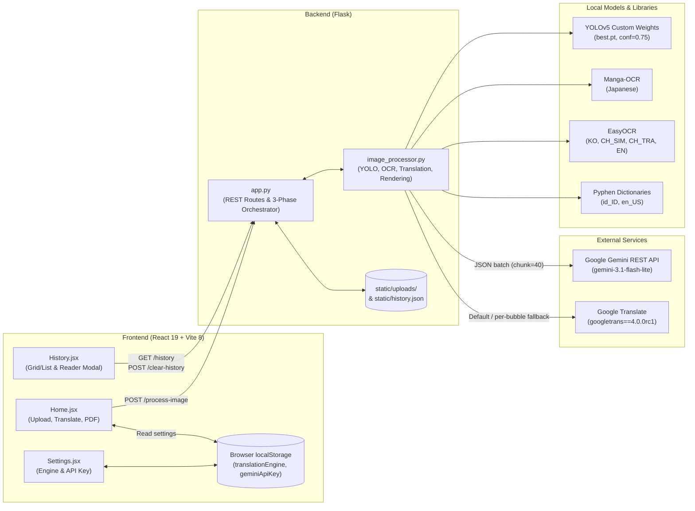
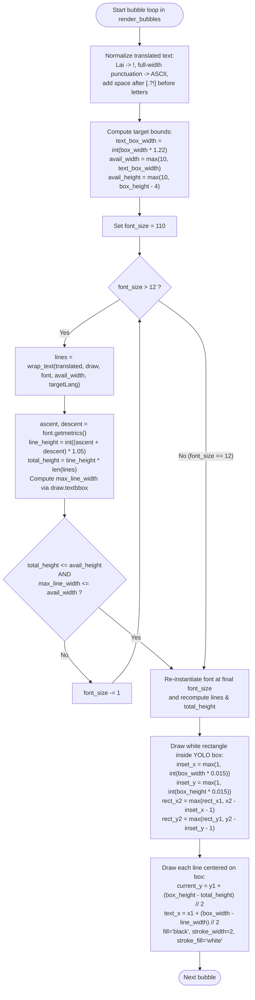

# Architecture & Codebase Reference (`scan-translator-v2`)

This document describes the architecture, processing pipeline, backend algorithms, REST API contract, frontend structure, and known technical limitations of `scan-translator-v2` based on the current source code.

---

## Table of Contents

1. [System Architecture & Directory Layout](#1-system-architecture--directory-layout)
2. [3-Phase Processing Pipeline](#2-3-phase-processing-pipeline)
3. [Backend Reference (`backend/`)](#3-backend-reference-backend)
   - [3.1. Flask Server & File Storage (`app.py`)](#31-flask-server--file-storage-apppy)
   - [3.2. Global Initialization & Language Mapping (`image_processor.py`)](#32-global-initialization--language-mapping-image_processorpy)
   - [3.3. Phase 1: Bubble Detection & OCR (`extract_bubbles`, `clean_ocr_text`)](#33-phase-1-bubble-detection--ocr-extract_bubbles-clean_ocr_text)
   - [3.4. Phase 2: Gemini Batch Translation & Fallback (`batch_gemini_translate`, `_parse_json_array`)](#34-phase-2-gemini-batch-translation--fallback-batch_gemini_translate-_parse_json_array)
   - [3.5. Phase 3: Layout Calculation, Hyphenation & Rendering (`break_word`, `wrap_text`, `render_bubbles`)](#35-phase-3-layout-calculation-hyphenation--rendering-break_word-wrap_text-render_bubbles)
4. [REST API Specification & Data Schemas](#4-rest-api-specification--data-schemas)
5. [Frontend Reference (`frontend/src/`)](#5-frontend-reference-frontendsrc)
6. [Extension Guides](#6-extension-guides)
7. [Known Technical Notes & Limitations](#7-known-technical-notes--limitations)

---

## 1. System Architecture & Directory Layout

The application uses a local two-tier client-server layout without an external database or task queue:

- **Frontend (`frontend/`)**: A React 19 Single-Page Application (Vite 8, React Router DOM 7, Tailwind CSS 4). It handles file selection, stores translation preferences in browser `localStorage`, sends requests to the Flask server, renders side-by-side image previews, and generates PDF downloads client-side via `jsPDF`.
- **Backend (`backend/`)**: A Flask server running synchronous image processing pipelines using PyTorch (YOLOv5), OpenCV, Manga-OCR, EasyOCR, `urllib.request` (Gemini REST API), `googletrans`, `pyphen`, and Pillow. Uploaded images, rendered outputs, and history metadata are persisted directly on the local filesystem.



### Directory Structure

```text
scan-translator-v2/
├── docs/
│   └── ARCHITECTURE.md          # Technical & codebase reference
├── backend/
│   ├── app.py                   # Flask app, routes, 3-phase orchestration, history I/O (133 LOC)
│   ├── image_processor.py       # YOLOv5, OCR, Gemini batch client, text wrapping, Pillow rendering (341 LOC)
│   ├── requirements.txt         # Python dependency list
│   ├── yolo-model/
│   │   └── bubble-detector-new/
│   │       └── weights/best.pt  # Custom YOLOv5 weights
│   └── static/
│       ├── history.json         # Persisted translation session list
│       ├── fonts/               # TrueType fonts (WinkyRough, TradeWinds)
│       └── uploads/             # Uploaded source images and output_* rendered images
├── frontend/
│   ├── package.json             # Dependencies and Vite/oxlint scripts
│   ├── public/                  # Static assets (hero banners, web fonts, SVG icons)
│   └── src/
│       ├── main.jsx             # React root entry point
│       ├── App.jsx              # React Router setup and layout wrapper
│       ├── index.css            # Tailwind v4 @theme tokens, @font-face declarations, custom CSS
│       ├── components/
│       │   └── Navbar.jsx       # Fixed top navigation bar
│       └── pages/
│           ├── Home.jsx         # Upload form, translation trigger, result preview, jsPDF export
│           ├── History.jsx      # History grid/list view, side-by-side modal, clear-all action
│           └── Settings.jsx     # Engine selector and Gemini API key form
└── README.md                    # User-facing setup and usage guide
```

### Technology Stack (Verified Against Manifests)

| Layer | Libraries & Versions |
| :--- | :--- |
| **Frontend** | `react` ^19.2.7, `react-dom` ^19.2.7, `react-router-dom` ^7.18.1, `vite` ^8.1.1, `tailwindcss` ^4.3.2 (`@tailwindcss/postcss`), `lucide-react` ^1.24.0, `jspdf` ^4.2.1, `oxlint` ^1.71.0 |
| **Backend** | `flask`, `flask-cors`, `werkzeug`, `torch`, `ultralytics`, `opencv-python-headless`, `Pillow`, `pandas`, `manga-ocr`, `easyocr`, `googletrans==4.0.0rc1`, `pyphen` *(plus standard library `urllib.request`, `json`, `re`, `pathlib`, `time`, `datetime`)* |

> **Note on `backend/requirements.txt`**: `google-genai` and `python-dotenv` are listed in `requirements.txt` but are not imported by `app.py` or `image_processor.py`. Gemini requests are sent directly with Python's built-in `urllib.request`.

---

## 2. 3-Phase Processing Pipeline

`POST /process-image` splits multi-image processing into three sequential phases across all uploaded files in a request. Instead of translating per image, all detected bubbles across all uploaded pages are accumulated first so they can be sent to the Gemini API in batches of up to 40 bubbles per HTTP request.

```mermaid
sequenceDiagram
    autonumber
    actor User
    participant FE as Frontend (Home.jsx)
    participant API as Flask (app.py)
    participant IP as image_processor.py
    participant Gemini as Gemini API
    participant GT as Google Translate

    User->>FE: Select image(s), source/target languages, click "Terjemahkan"
    FE->>FE: Read translationEngine & geminiApiKey from localStorage
    FE->>API: POST /process-image (FormData: image[], source, target, engine, apiKey)

    API->>IP: selectOCR(sourceLang)
    IP-->>API: ocr instance (MangaOcr or EasyOCR), index, translate_code

    rect rgb(40, 45, 60)
        Note over API,IP: Phase 1: YOLOv5 Detection + OCR for all uploaded images
        loop For each uploaded file (img_idx)
            API->>API: Save file to static/uploads/{name}_{timestamp}_{idx}.{ext}
            API->>IP: extract_bubbles(filepath, ocr, index, translate_code, image_id)
            IP->>IP: Run YOLOv5 inference (conf=0.75) -> crop boxes -> run OCR -> clean_ocr_text()
            IP-->>API: img_pil, draw, bubbles[] (id: "{img_idx}_{bubble_idx}")
            API->>API: Append context to image_contexts[] and extend all_bubbles[]
        end
    end

    rect rgb(45, 60, 45)
        Note over API,GT: Phase 2: Batch Gemini Translation & Per-Bubble Fallback
        alt engine == "gemini" and apiKey is non-empty
            API->>IP: batch_gemini_translate(all_bubbles, translate_code, targetLang, apiKey)
            loop For each chunk of up to 40 non-empty bubbles
                IP->>Gemini: POST generateContent (JSON array [{id, text}])
                Gemini-->>IP: JSON array [{id, translated}] (or 429/503 -> up to 1 retry)
            end
            IP-->>API: translations dict {bubble_id: translated_text}
        end
        loop For each bubble b in all_bubbles
            alt translations.get(b["id"]) is empty/missing
                alt b["cleaned_text"].strip() is non-empty
                    API->>GT: translator.translate(b["cleaned_text"], src=translate_code, dest=targetLang)
                    GT-->>API: translated string
                else OCR text is empty
                    API->>API: Set translations[b["id"]] = "[Teks tidak terbaca]"
                end
            end
        end
    end

    rect rgb(60, 45, 45)
        Note over API,IP: Phase 3: Layout Calculation & Rendering
        loop For each image context
            API->>IP: render_bubbles(img_pil, draw, bubbles, translations, targetLang)
            IP->>IP: Fit font size (110 -> 12), wrap/hyphenate text, draw white box & centered text
            API->>API: Save output image to static/uploads/output_{filename}
        end
    end

    API->>API: Prepend session metadata to static/history.json
    API-->>FE: HTTP 200 { results: [{ original, translated }, ...] }
    FE-->>User: Render side-by-side results & show DOWNLOAD PDF button
```



---

## 3. Backend Reference (`backend/`)

### 3.1. Flask Server & File Storage (`app.py`)

`backend/app.py` (133 lines) initializes a Flask application with unrestricted CORS (`CORS(app)`) and manages two relative filesystem paths:

- `UPLOAD_FOLDER = os.path.join("static", "uploads")` (created automatically via `os.makedirs(..., exist_ok=True)`).
- `HISTORY_FILE = os.path.join("static", "history.json")`.

Uploaded filenames are sanitized with `werkzeug.utils.secure_filename` and tagged with a request-scoped timestamp (`%Y%m%d_%H%M%S`) and 1-based image index:

```python
filename = f"{name}_{timestamp}_{img_idx+1}{ext}"
# Example source : page01_20261120_091959_1.webp
# Example output : output_page01_20261120_091959_1.webp
```

History entries are read and written via `load_history()` and `save_history()`, with new entries inserted at index `0` (`history.insert(0, history_entry)`). `load_history()` returns `[]` if `history.json` is missing or cannot be parsed.

---

### 3.2. Global Initialization & Language Mapping (`image_processor.py`)

When `image_processor.py` (341 lines) is imported by `app.py`, module-level code executes immediately:

1. **Hyphenation dictionaries** (lines 16–17):
   ```python
   dic_id = pyphen.Pyphen(lang='id_ID')
   dic_en = pyphen.Pyphen(lang='en_US')
   ```
2. **Windows `pathlib` override** (line 19):
   ```python
   pathlib.PosixPath = pathlib.WindowsPath
   ```
   Replaces `PosixPath` with `WindowsPath` so PyTorch weights pickled on Linux can be unpickled on Windows.
3. **YOLOv5 model load** (lines 21–23):
   ```python
   model_path = "yolo-model/bubble-detector-new/weights/best.pt"
   model = torch.hub.load('ultralytics/yolov5', 'custom', path=model_path, source='github', force_reload=True)
   model.conf = 0.75
   ```
   Only detections with confidence `>= 0.75` are retained.
4. **Google Translate client** (line 25):
   ```python
   translator = Translator()
   ```

#### Language Mapping (`get_language_codes` & `selectOCR`)

`get_language_codes(sourceLang)` validates `sourceLang` and returns `(easyocr_code, translate_code)`, raising `ValueError` for unknown codes. `selectOCR(sourceLang)` returns `(ocr_instance, index, translate_code)`:

| `sourceLang` | OCR Engine Instantiated | `index` | `translate_code` | Exposed in `Home.jsx` UI? |
| :--- | :--- | :---: | :--- | :---: |
| `jp` | `MangaOcr()` | `0` | `ja` | Yes |
| `ko` | `easyocr.Reader(['ko'])` | `1` | `ko` | Yes |
| `ch_sim` | `easyocr.Reader(['ch_sim'])` | `1` | `zh-cn` | Yes |
| `ch_tra` | `easyocr.Reader(['ch_tra'])` | `1` | `zh-tw` | No |
| `en` | `easyocr.Reader(['en'])` | `1` | `en` | Yes |

---

### 3.3. Phase 1: Bubble Detection & OCR (`extract_bubbles`, `clean_ocr_text`)

`extract_bubbles(image_path, ocr, index, translate_code, image_id)` (lines 225–260):

1. Reads the image from disk with `cv2.imread(image_path)`, converts BGR to RGB (`cv2.cvtColor`), and wraps it into `PIL.Image` (`img_pil`) and `ImageDraw.Draw` (`draw`).
2. Runs `results = model(img_rgb)` and extracts bounding boxes from `results.pandas().xyxy[0]`.
3. For each detected row (`bubble_idx`):
   - Rounds `xmin`, `ymin`, `xmax`, `ymax` to integers `x1, y1, x2, y2`, and records `orig_box_width = x2 - x1`, `orig_box_height = y2 - y1`.
   - Crops `img_pil.crop((x1, y1, x2, y2))`.
   - Runs OCR:
     - `index == 0`: calls `ocr(cropped)` (`MangaOcr`).
     - `index != 0`: converts the crop to a NumPy array and calls `" ".join(ocr.readtext(cropped_np, detail=0))` (`EasyOCR`).
   - Passes the extracted string through `clean_ocr_text(text)` (lines 64–69):
     - Replaces standalone `\bLai\b` with `!` (regex artifact correction).
     - Collapses consecutive whitespace (`\s+`) into a single space and strips outer whitespace.
   - Appends a dictionary to `bubbles`:
     ```python
     {
         "id": f"{image_id}_{bubble_idx}",
         "x1": x1, "y1": y1, "x2": x2, "y2": y2,
         "orig_box_width": orig_box_width,
         "orig_box_height": orig_box_height,
         "ocr_text": text,
         "cleaned_text": cleaned_text,
     }
     ```
4. Returns `(img_pil, draw, bubbles)`. *(Note: the `translate_code` parameter is accepted in the signature but unused inside the function.)*

---

### 3.4. Phase 2: Gemini Batch Translation & Fallback (`batch_gemini_translate`, `_parse_json_array`)

`batch_gemini_translate(bubbles, source_lang, target_lang, api_key, batch_size=40, max_retries=1)` (lines 89–157):

1. **Sanitization & Filtering**:
   - Cleans `api_key` using `.strip().replace('"', '').replace("'", "")`.
   - Collects only non-empty texts: `items = [{"id": b["id"], "text": b["cleaned_text"]} for b in bubbles if b["cleaned_text"].strip()]`. Returns `{}` early if `items` is empty.
2. **Batch Request Construction**:
   - Iterates `items` in slices of `batch_size` (default `40`).
   - Sends an HTTP POST request via `urllib.request.Request` to:
     ```text
     https://generativelanguage.googleapis.com/v1beta/models/gemini-3.1-flash-lite:generateContent
     ```
   - Headers: `Content-Type: application/json`, `x-goog-api-key: <api_key>`.
   - Payload: a prompt containing the JSON-serialized chunk asking for a JSON array of `{"id": ..., "translated": ...}` objects in the same order, with `"generationConfig": {"temperature": 0.3}`.
3. **JSON Extraction (`_parse_json_array`, lines 71–87)**:
   - Strips leading ```` ``` ```` / ```` ```json ```` and trailing ```` ``` ```` fences.
   - Calls `json.loads(text)`. If `JSONDecodeError` occurs, locates the first `[` and last `]` and retries `json.loads` on that substring. Returns `[]` if parsing still fails.
   - Populates `translations[obj["id"]] = obj["translated"]` for each parsed object containing both `"id"` and `"translated"`.
4. **Retry Behavior on `HTTPError`**:
   - Loops `for attempt in range(max_retries + 1)` (default `max_retries=1` yields 1 initial attempt + up to 1 retry).
   - On HTTP `429` or `503` while `attempt < max_retries`:
     - If `e.code == 429` and `'PerDay'` is present in `error_body`, exits the retry loop immediately.
     - Otherwise calculates `wait = 4 * (attempt + 1)`. For `429`, attempts to parse `error.details` for a `@type` ending in `"RetryInfo"` and overrides `wait = float(d["retryDelay"].rstrip("s")) + 0.5`.
     - Calls `time.sleep(wait)` and retries.
   - Any other `HTTPError` or `Exception` logs to stdout and breaks out of the chunk loop; missing bubble IDs are left out of `translations`.
5. **Per-Bubble Fallback in `app.py` (lines 71–79)**:
   - After `batch_gemini_translate` returns (or when `engine != 'gemini'` or `api_key` is empty), `app.py` iterates every bubble in `all_bubbles`.
   - Any bubble without a truthy value in `translations[b['id']]` is translated individually via `translator.translate(b['cleaned_text'], src=translate_code, dest=targetLang).text` if `cleaned_text.strip()` is non-empty, or assigned `"[Teks tidak terbaca]"`.

---

### 3.5. Phase 3: Layout Calculation, Hyphenation & Rendering (`break_word`, `wrap_text`, `render_bubbles`)

`render_bubbles(img_pil, draw, bubbles, translations, targetLang, font_path="static/fonts/Winky_Rough/WinkyRough-Regular.ttf")` (lines 262–341) overwrites each detected bubble region in place on `img_pil`.



#### Post-Translation Text Normalization (lines 266–272)
- Non-empty bubbles fetch `translations.get(b["id"]) or "[Teks tidak terbaca]"`, then apply:
  - `re.sub(r'\bLai\b', '!', translated)`
  - `.replace('．', '.').replace('…', '...').replace('。', '.')`
  - `re.sub(r'([.?!])([a-zA-Z])', r'\1 \2', translated)`
- Empty `cleaned_text` bubbles use `"[Teks tidak terbaca]"`.

#### Word Wrapping & Hyphenation (`wrap_text` & `break_word`, lines 159–223)
- `wrap_text` splits text on whitespace (`text.split()`) and appends words to `current_line` as long as `draw.textbbox((0, 0), test_line, font=font)` width `<= max_width`.
- When a single word exceeds `max_width`, `break_word` is called:
  1. **Length guard**: If `len(word) <= 5`, returns `[word]` unsplit.
  2. **Dictionary selection**: Uses `dic_id` (`id_ID`) when `target_lang == 'id'`, `dic_en` (`en_US`) when `target_lang == 'en'`, or `None` otherwise.
  3. **Syllable split**: Calls `dic.inserted(word).split('-')`. If `dic` is `None` or returns `<= 1` segment (and `len(word) > 3`), splits into individual characters (`list(word)`).
  4. **Line assembly**: Accumulates segments while measuring `current_part + syl + ("-" if not last else "")` against `max_width`, emitting lines with trailing hyphens `-` for non-final segments.

#### Box & Text Geometry (lines 278–341)
- **Available text width**: `avail_width = max(10, int(box_width * 1.22))` (note discrepancy with the inline comment at line 282; see [Section 7](#7-known-technical-notes--limitations)).
- **Available text height**: `avail_height = max(10, box_height - 4)`.
- **Font size search**: Linear downward search from `110` down to `12` in steps of `1`, using `line_spacing_factor = 1.05` on `(ascent + descent)`.
- **Background mask**: White rectangle (`fill="white"`) inset from `(x1, y1, x2, y2)` by `inset_x = max(1, int(box_width * 0.015))` and `inset_y = max(1, int(box_height * 0.015))`, with right/bottom edges clamped to `max(rect_x1, x2 - inset_x - 1)` and `max(rect_y1, y2 - inset_y - 1)`.
- **Text drawing**: Each line is horizontally centered relative to `orig_box_width` (`text_x = x1 + (box_width - line_width) // 2`) and vertically centered relative to `orig_box_height` (`current_y = y1 + (box_height - total_height) // 2`), rendered with `fill="black"`, `stroke_width=2`, `stroke_fill="white"`.

---

## 4. REST API Specification & Data Schemas

Flask runs on `0.0.0.0:5000` (`debug=True`), and frontend requests target `http://127.0.0.1:5000`.

### 4.1. `POST /process-image`

Processes one or more uploaded comic images through all three phases, writes output images, and prepends a history record to `backend/static/history.json`.

- **Content-Type**: `multipart/form-data`
- **Form Fields**:

  | Field | Type | Required | Notes |
  | :--- | :--- | :---: | :--- |
  | `image[]` | `File[]` | Yes | Missing field returns `400` (`{"error": "No image provided"}`). |
  | `source` | `string` | Yes | Valid values in `get_language_codes`: `jp`, `ko`, `ch_sim`, `ch_tra`, `en`. Omitting raises `KeyError` (`500`). |
  | `target` | `string` | Yes | Typically `id` or `en`. Omitting raises `KeyError` (`500`). |
  | `engine` | `string` | No | Defaults to `googletrans`. Accepts `gemini` to enable Gemini batching. |
  | `apiKey` | `string` | No | Defaults to `""`. Used when `engine == "gemini"`. |

- **Success Response (`200 OK`)**:
  ```json
  {
    "results": [
      {
        "original": "http://127.0.0.1:5000/static/uploads/01_20261120_091959_1.webp",
        "translated": "http://127.0.0.1:5000/static/uploads/output_01_20261120_091959_1.webp"
      }
    ]
  }
  ```
- **Error Responses (`400 Bad Request` / `500 Internal Server Error`)**:
  ```json
  {
    "error": "<error message>"
  }
  ```

### 4.2. `GET /history`

Returns the JSON array stored in `backend/static/history.json` (or `[]` if absent/unreadable).

- **Success Response (`200 OK`)**:
  ```json
  [
    {
      "id": 1795141227526,
      "date": "20/11/2026, 09.20.27",
      "sourceLang": "jp",
      "targetLang": "id",
      "engine": "googletrans",
      "images": [
        {
          "original": "http://127.0.0.1:5000/static/uploads/01_20261120_091959_1.webp",
          "translated": "http://127.0.0.1:5000/static/uploads/output_01_20261120_091959_1.webp"
        }
      ]
    }
  ]
  ```

### 4.3. `POST /clear-history`

Overwrites `backend/static/history.json` with `[]` and deletes all regular files (`os.path.isfile`) in `backend/static/uploads/`.

- **Success Response (`200 OK`)**:
  ```json
  {
    "status": "success"
  }
  ```

---

## 5. Frontend Reference (`frontend/src/`)

### 5.1. Routing & Navigation
- `App.jsx`: Wraps the app in `BrowserRouter`, renders fixed `Navbar` (`80px` height), and maps routes inside `<main className="pt-[80px]">`:
  - `/` -> `pages/Home.jsx`
  - `/history` -> `pages/History.jsx`
  - `/settings` -> `pages/Settings.jsx`
- `components/Navbar.jsx`: Displays the `Comic Translator` title (`TradeWinds` font) and active-state route links (`Home`, `History`, `Settings`).

### 5.2. Pages & Client-Side State
- **`pages/Home.jsx` (267 lines)**:
  - Component state: `selectedFiles`, `sourceLang`, `targetLang`, `statusText`, `statusColor`, `isProcessing`, `results`, plus `timerRef` / `startTimeRef` for a 1-second elapsed-time counter.
  - `translateImage()`: Validates file selection, language dropdowns, and presence of `geminiApiKey` when `translationEngine === 'gemini'`; posts `FormData` to `http://127.0.0.1:5000/process-image`.
  - `downloadPDF()`: Instantiates `new jsPDF()` (default A4 portrait), loads each `result.translated` URL via `new Image()` with `crossOrigin = 'anonymous'`, scales each image by `Math.min(pageWidth / img.width, pageHeight / img.height)` centered on its page, embeds it via `pdf.addImage(img, 'JPEG', x, y, w, h)`, and triggers download as `hasil_gambar.pdf`.
- **`pages/History.jsx` (147 lines)**:
  - Fetches `GET http://127.0.0.1:5000/history` on mount.
  - Supports toggling `viewMode` between `'grid'` (default, 1/2/3 responsive columns) and `'list'` (horizontal cards). Each card previews `item.images[0]?.original`.
  - Clicking a card sets `selectedItem` to open a fullscreen modal (`z-[100]`) rendering all `original` and `translated` image pairs.
  - `clearHistory()` confirms via `window.confirm` and calls `POST http://127.0.0.1:5000/clear-history`.
- **`pages/Settings.jsx` (93 lines)**:
  - Reads and writes two browser `localStorage` keys:
    - `translationEngine`: `'googletrans'` (default) or `'gemini'`
    - `geminiApiKey`: trimmed API key string
  - Displays a confirmation message for 3 seconds after saving.

### 5.3. Styling (`frontend/src/index.css`)
Theme tokens are declared via Tailwind CSS v4 `@theme` in `frontend/src/index.css`:
- Colors: `--color-brand-dark: #1E1E1E`, `--color-brand-blue: #267BFA`, `--color-brand-blue-hover: #0043a8`
- Fonts: `--font-winky: 'WinkyRough', sans-serif`, `--font-trade: 'TradeWinds', sans-serif` (loaded via `@font-face` from `/fonts/Winky_Rough/WinkyRough-Regular.ttf` and `/fonts/Trade_Winds/TradeWinds-Regular.ttf`).

---

## 6. Extension Guides

### Adding a Source or Target Language
1. **Backend (`backend/image_processor.py`)**:
   - Add an entry to `mapping` inside `get_language_codes(sourceLang)` mapping the form code to `(easyocr_code, translate_code)`.
   - To enable hyphenation for a new target language, instantiate a `pyphen.Pyphen(lang='...')` dictionary at module level and add a branch in `break_word()`.
2. **Frontend (`frontend/src/pages/Home.jsx`)**:
   - Add a matching `<option value="...">` element under `<select id="source-lang">` or `<select id="target-lang">`.

### Changing the Rendered Comic Font
1. Place the `.ttf` font file under `backend/static/fonts/`.
2. Update the default `font_path` parameter of `render_bubbles()` in `backend/image_processor.py`:
   ```python
   def render_bubbles(img_pil, draw, bubbles, translations, targetLang,
                       font_path="static/fonts/<folder>/<font>.ttf"):
   ```

### Changing the Gemini Model or Batch Size
- In `backend/image_processor.py`, update `url` (line 98) and/or the `batch_size=40` / `max_retries=1` default parameters in `batch_gemini_translate()` (line 89).

---

## 7. Known Technical Notes & Limitations

The following behaviors were verified directly in the source code and should be considered when maintaining or deploying the project:

1. **Working Directory Sensitivity**: `app.py` and `image_processor.py` reference relative paths (`yolo-model/...`, `static/uploads`, `static/history.json`, `static/fonts/...`). Running `python app.py` from any directory other than `backend/` will fail to resolve these files.
2. **YOLOv5 `force_reload=True` on Startup**: Line 22 of `image_processor.py` calls `torch.hub.load(..., source='github', force_reload=True)`, requiring GitHub network access on every startup instead of reusing the local PyTorch Hub cache.
3. **Flask `debug=True` Double Import**: Line 133 of `app.py` runs `app.run(host="0.0.0.0", port=5000, debug=True)`. Werkzeug's auto-reloader imports `image_processor.py` in both parent and child processes, loading YOLOv5 twice at startup.
4. **Per-Request OCR Instantiation**: `selectOCR(sourceLang)` creates a new `MangaOcr()` or `easyocr.Reader(...)` instance on every `POST /process-image` request instead of caching OCR readers across requests.
5. **Windows-Only `pathlib` Monkey-Patch**: Line 19 of `image_processor.py` unconditionally sets `pathlib.PosixPath = pathlib.WindowsPath`. On Linux/macOS this raises `NotImplementedError` unless guarded by `if os.name == 'nt':`.
6. **Comment vs. Implementation Mismatch on Horizontal Expansion**: In `image_processor.py` lines 282–283, the inline comment states `"22% to the left and 22% to the right (1.44x total box_width)"`, while the code computes `text_box_width = int(box_width * 1.22)` (`1.22x` total box width, or `11%` per side when centered).
7. **Hardcoded `http://127.0.0.1:5000` URLs**: Backend URLs are hardcoded in `Home.jsx`, `History.jsx`, and the `original`/`translated` URLs written into `backend/static/history.json`.
8. **Unguarded `googletrans` Fallback Exceptions**: In `app.py` lines 72–79, per-bubble calls to `translator.translate(...)` are not wrapped in an inner `try/except`; a network or library error from `googletrans` aborts the entire request with HTTP `500`.
9. **Uncleaned Timer on Unmount**: `Home.jsx` starts a `setInterval` in `timerRef` without a cleanup `useEffect` on component unmount (`useEffect` is imported on line 1 but unused).
10. **Unused Legacy Code & Files**:
    - `backend/image_processor.py`: `process_language()` (lines 27–40) is unused; `import numpy as np` is duplicated (lines 3 and 7); `translate_code` parameter in `extract_bubbles()` is unused.
    - `backend/requirements.txt`: `google-genai` and `python-dotenv` are not imported anywhere in the backend.
    - `frontend/`: `src/App.css` is not imported, and `tailwind.config.js` is superseded by Tailwind v4's `@theme` block in `src/index.css`.
