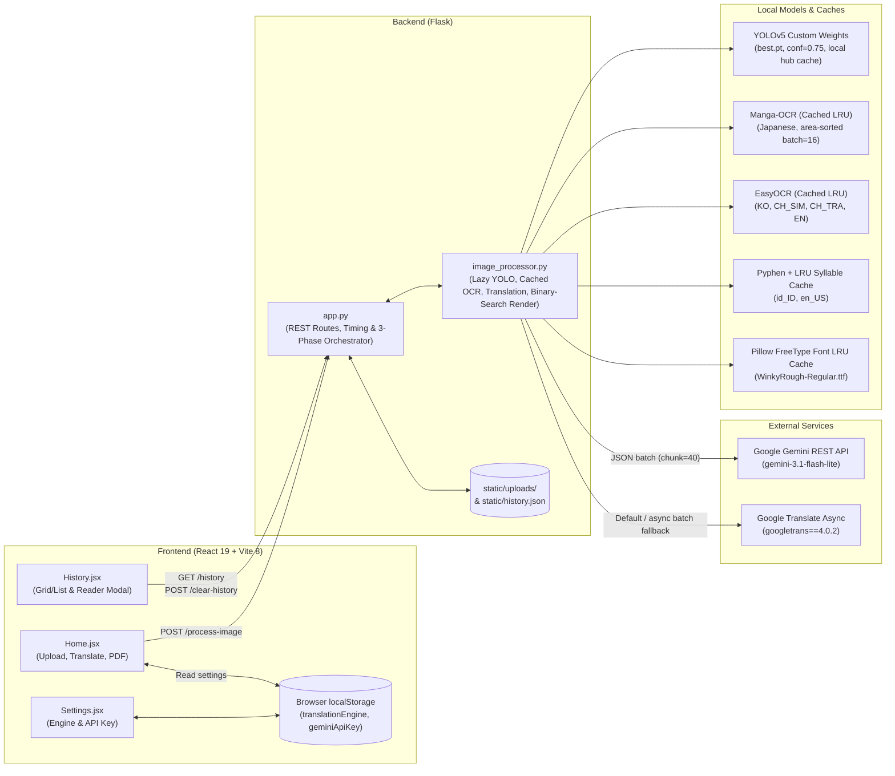
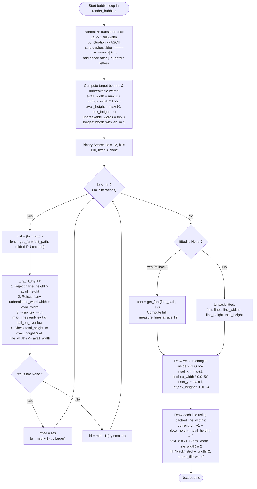

# Architecture & Codebase Reference (`scan-translator-v2`)

This document describes the architecture, 3-phase processing pipeline, backend algorithms, REST API contract, frontend structure, test suite, and known technical limitations of `scan-translator-v2` based on the current source code.

---

## Table of Contents

1. [System Architecture & Directory Layout](#1-system-architecture--directory-layout)
2. [3-Phase Processing Pipeline](#2-3-phase-processing-pipeline)
3. [Backend Reference (`backend/`)](#3-backend-reference-backend)
   - [3.1. Flask Server, Startup Warmup & Timing Logs (`app.py`)](#31-flask-server-startup-warmup--timing-logs-apppy)
   - [3.2. Global Initialization, Lazy YOLOv5 Loader & OCR Cache (`image_processor.py`)](#32-global-initialization-lazy-yolov5-loader--ocr-cache-image_processorpy)
   - [3.3. Phase 1: Bubble Detection, Batched OCR & Text Cleaning (`detect_bubbles`, `batch_manga_ocr`, `extract_bubbles`, `clean_ocr_text`)](#33-phase-1-bubble-detection-batched-ocr--text-cleaning-detect_bubbles-batch_manga_ocr-extract_bubbles-clean_ocr_text)
   - [3.4. Phase 2: Gemini Batch Translation & Async Google Translate Fallback (`batch_gemini_translate`, `batch_google_translate`)](#34-phase-2-gemini-batch-translation--async-google-translate-fallback-batch_gemini_translate-batch_google_translate)
   - [3.5. Phase 3: Layout Calculation, Hyphenation & Rendering (`get_font`, `_split_syllables`, `break_word`, `wrap_text`, `_try_fit_layout`, `render_bubbles`)](#35-phase-3-layout-calculation-hyphenation--rendering-get_font-_split_syllables-break_word-wrap_text-_try_fit_layout-render_bubbles)
   - [3.6. Automated Test Suite (`backend/tests/`)](#36-automated-test-suite-backendtests)
4. [REST API Specification & Data Schemas](#4-rest-api-specification--data-schemas)
5. [Frontend Reference (`frontend/src/`)](#5-frontend-reference-frontendsrc)
6. [Extension Guides](#6-extension-guides)
7. [Known Technical Notes & Limitations](#7-known-technical-notes--limitations)

---

## 1. System Architecture & Directory Layout

The application uses a local two-tier client-server layout without an external database or task queue:

- **Frontend (`frontend/`)**: A React 19 Single-Page Application (Vite 8, React Router DOM 7, Tailwind CSS 4). It handles file selection, stores translation preferences in browser `localStorage`, sends requests to the Flask server, renders side-by-side image previews, and generates PDF downloads client-side via `jsPDF`.
- **Backend (`backend/`)**: A Flask server running synchronous 3-phase image processing pipelines using PyTorch (YOLOv5), OpenCV, Manga-OCR (cross-page batched inference), EasyOCR (zero-copy NumPy views), `urllib.request` (Gemini REST API), `googletrans==4.0.2` (async batch fallback), `pyphen`, and Pillow. Uploaded images, rendered outputs, and history metadata are persisted directly on the local filesystem.



### Directory Structure

```text
scan-translator-v2/
├── docs/
│   └── ARCHITECTURE.md          # Technical & codebase reference
├── backend/
│   ├── app.py                   # Flask app, routes, 3-phase orchestration, timing logs, history I/O (203 LOC)
│   ├── image_processor.py       # YOLOv5 loader, OCR cache, batched Manga-OCR, translation, rendering (669 LOC)
│   ├── requirements.txt         # Python dependency list (12 packages)
│   ├── tests/                   # Unit & integration test suite (6 modules, 36 tests)
│   │   ├── test_bubble_extraction.py
│   │   ├── test_manga_ocr_batch.py
│   │   ├── test_ocr_cache.py
│   │   ├── test_render_bubbles.py
│   │   ├── test_text_cleaning_and_hyphenation.py
│   │   └── test_yolo_loader.py
│   ├── yolo-model/
│   │   └── bubble-detector-new/
│   │       └── weights/best.pt  # Custom YOLOv5 weights
│   └── static/
│       ├── history.json         # Persisted translation session list
│       ├── fonts/               # TrueType fonts (WinkyRough, TradeWinds)
│       └── uploads/             # Uploaded source images and output_* rendered images
├── frontend/
│   ├── package.json             # Dependencies and Vite/oxlint scripts
│   ├── public/                  # Static assets (hero banners, web fonts, SVG icons)
│   └── src/
│       ├── main.jsx             # React root entry point
│       ├── App.jsx              # React Router setup and layout wrapper
│       ├── index.css            # Tailwind v4 @theme tokens, @font-face declarations, custom CSS
│       ├── components/
│       │   └── Navbar.jsx       # Fixed top navigation bar
│       └── pages/
│           ├── Home.jsx         # Upload form, translation trigger, result preview, jsPDF export
│           ├── History.jsx      # History grid/list view, side-by-side modal, clear-all action
│           └── Settings.jsx     # Engine selector and Gemini API key form
├── PERFORMANCE_AUDIT.md         # Performance audit, benchmark progression & optimization roadmap
└── README.md                    # User-facing setup and usage guide
```

### Technology Stack (Verified Against Manifests)

| Layer | Libraries & Versions |
| :--- | :--- |
| **Frontend** | `react` ^19.2.7, `react-dom` ^19.2.7, `react-router-dom` ^7.18.1, `vite` ^8.1.1, `tailwindcss` ^4.3.2 (`@tailwindcss/postcss`), `lucide-react` ^1.24.0, `jspdf` ^4.2.1, `oxlint` ^1.71.0 |
| **Backend** | `flask`, `flask-cors`, `werkzeug`, `torch`, `ultralytics`, `opencv-python-headless`, `Pillow`, `manga-ocr`, `easyocr`, `googletrans==4.0.2`, `pyphen` *(plus standard library `asyncio`, `collections.OrderedDict`, `functools.lru_cache`, `os`, `threading`, `urllib.request`, `json`, `re`, `pathlib`, `time`, `datetime`)* |

> **Note on `backend/requirements.txt`**: `python-dotenv` and `pandas` are listed in `requirements.txt` but are not imported by `app.py` or `image_processor.py` (YOLOv5 detections are read directly from the `results.xyxy[0]` tensor without constructing a Pandas DataFrame).

---

## 2. 3-Phase Processing Pipeline

`POST /process-image` splits multi-image processing into three sequential phases across all uploaded files in a request:

1. **Phase 1 (Bubble Detection & OCR)**:
   - For **Japanese (`jp`, `index == 0`)**: Runs YOLOv5 detection (`detect_bubbles`) across all uploaded pages first to collect all bubble bounding boxes and PIL crops, then executes `batch_manga_ocr` once across all collected crops in area-sorted batches of `16` (`MANGA_OCR_BATCH_SIZE = 16`), and normalizes each extracted string with `clean_ocr_text()`.
   - For **Other Languages (`ko`, `ch_sim`, `ch_tra`, `en`, `index == 1`)**: Runs YOLOv5 detection and EasyOCR per image inside `extract_bubbles` using zero-copy NumPy slices (`img_rgb[y1:y2, x1:x2]`) and `clean_ocr_text()`.
2. **Phase 2 (Batch Translation & Async Fallback)**:
   - Sends all non-empty bubbles across all uploaded pages to Gemini (`batch_gemini_translate`, chunks of up to `40` bubbles) when `engine == "gemini"` and `apiKey` is provided.
   - Translates any remaining untranslated bubbles via `batch_google_translate` (`googletrans==4.0.2` async batching), or assigns `"[Teks tidak terbaca]"` for empty OCR text.
3. **Phase 3 (Binary-Search Typesetting & Rendering)**:
   - Fits the largest font size in `[12, 110]` using binary search (`<= 7` iterations per bubble) with fast unbreakable-word rejection, early line-count exit, cached `ImageFont.truetype` instances, and cached `pyphen` syllable splits, then draws the white background inset box and centered stroked text on each page.

```mermaid
sequenceDiagram
    autonumber
    actor User
    participant FE as Frontend (Home.jsx)
    participant API as Flask (app.py)
    participant IP as image_processor.py
    participant Gemini as Gemini API
    participant GT as Google Translate (4.0.2)

    User->>FE: Select image(s), source/target languages, click "Terjemahkan"
    FE->>FE: Read translationEngine & geminiApiKey from localStorage
    FE->>API: POST /process-image (FormData: image[], source, target, engine, apiKey)

    API->>IP: selectOCR(sourceLang) (Thread-safe LRU cache, max=2)
    IP-->>API: cached ocr instance (MangaOcr or EasyOCR), index, translate_code

    rect rgb(40, 45, 60)
        Note over API,IP: Phase 1: YOLOv5 Detection + Cross-Page Batched / Zero-Copy OCR
        alt index == 0 (Japanese / Manga-OCR)
            loop For each uploaded file (img_idx)
                API->>API: Save file to static/uploads/{name}_{timestamp}_{idx}.{ext}
                API->>IP: detect_bubbles(filepath, image_id=img_idx, timings=img_timings)
                IP->>IP: In-place BGR->RGB -> YOLOv5 (torch.inference_mode, xyxy tensor) -> crop PIL boxes
                IP-->>API: img_pil, bubbles[], pending_crops[]
            end
            API->>IP: batch_manga_ocr(ocr, all_pending_crops, batch_size=16)
            IP->>IP: Sort crops by area -> batched ViT+BERT generate -> clean_ocr_text()
            IP-->>API: Populate bubble["ocr_text"] & bubble["cleaned_text"]
        else index == 1 (EasyOCR: ko, ch_sim, ch_tra, en)
            loop For each uploaded file (img_idx)
                API->>API: Save file to static/uploads/{name}_{timestamp}_{idx}.{ext}
                API->>IP: extract_bubbles(filepath, ocr, index, translate_code, image_id=img_idx, timings=img_timings)
                IP->>IP: In-place BGR->RGB -> YOLOv5 -> zero-copy img_rgb[y1:y2, x1:x2] -> EasyOCR -> clean_ocr_text()
                IP-->>API: img_pil, bubbles[]
            end
        end
    end

    rect rgb(45, 60, 45)
        Note over API,GT: Phase 2: Batch Gemini Translation & Async Google Translate Fallback
        alt engine == "gemini" and apiKey is non-empty
            API->>IP: batch_gemini_translate(all_bubbles, translate_code, targetLang, apiKey)
            loop For each chunk of up to 40 non-empty bubbles
                IP->>Gemini: POST generateContent (JSON array [{id, text}])
                Gemini-->>IP: JSON array [{id, translated}] (or 429/503 -> up to 1 retry)
            end
            IP-->>API: translations dict {bubble_id: translated_text}
        end
        API->>IP: batch_google_translate(all_bubbles, translate_code, targetLang, translations)
        alt Pending untranslated non-empty bubbles exist
            IP->>GT: asyncio.run(_async_google_translate(pending, src, dest))
            GT-->>IP: translated strings
        end
        IP-->>API: completed translations dict (empty OCR -> "[Teks tidak terbaca]")
    end

    rect rgb(60, 45, 45)
        Note over API,IP: Phase 3: Binary-Search Layout Calculation & Rendering
        loop For each image context
            API->>IP: render_bubbles(img_pil, bubbles, translations, targetLang)
            IP->>IP: Binary search font size [12..110] with cached font/syllables & early-exit wrapping
            IP->>IP: Draw white inset box & centered stroked text
            API->>API: Save output image to static/uploads/output_{filename}
        end
    end

    API->>API: Prepend session metadata to static/history.json & print [Timing] summary
    API-->>FE: HTTP 200 { results: [{ original, translated }, ...] }
    FE-->>User: Render side-by-side results & show DOWNLOAD PDF button
```



---

## 3. Backend Reference (`backend/`)

### 3.1. Flask Server, Startup Warmup & Timing Logs (`app.py`)

`backend/app.py` (203 lines) initializes a Flask application with unrestricted CORS (`CORS(app)`) and manages two relative filesystem paths:

- `UPLOAD_FOLDER = os.path.join("static", "uploads")` (created automatically via `os.makedirs(..., exist_ok=True)`).
- `HISTORY_FILE = os.path.join("static", "history.json")`.

Uploaded filenames are sanitized with `werkzeug.utils.secure_filename` and tagged with a request-scoped timestamp (`%Y%m%d_%H%M%S`) and 1-based image index:

```python
filename = f"{name}_{timestamp}_{img_idx+1}{ext}"
# Example source : page01_20261121_065523_1.jpg
# Example output : output_page01_20261121_065523_1.jpg
```

- **Startup YOLOv5 Warmup & Single-Process Server (lines 199–203)**:
  When executed directly (`if __name__ == '__main__':`), `app.py` pre-warms YOLOv5 by calling `get_yolo_model()` before starting Flask with `use_reloader=False`:
  ```python
  if __name__ == '__main__':
      t0 = time.perf_counter()
      get_yolo_model()
      print(f"[Startup] YOLOv5 ready in {time.perf_counter() - t0:.2f}s")
      app.run(host="0.0.0.0", port=5000, debug=True, use_reloader=False)
  ```
  This prevents Werkzeug from spawning a duplicate parent reloader process while ensuring the first HTTP request does not pay the YOLOv5 initialization cost.
- **Per-Phase Timing Instrumentation (lines 56–173)**:
  `process_image_endpoint()` records wall-clock durations via `time.perf_counter()` across every stage and prints a summary line at the end of each request:
  ```text
  [Timing] total=15.80s | ocr_load=0.00s | read=0.06s | yolo=0.35s | ocr_infer=10.09s | gemini=3.90s | gtrans=0.00s | render=0.70s | save=0.02s | (4 img, 34 bubbles)
  ```

---

### 3.2. Global Initialization, Lazy YOLOv5 Loader & OCR Cache (`image_processor.py`)

When `image_processor.py` (669 lines) is imported by `app.py`:

1. **Hyphenation dictionaries** (lines 21–22):
   ```python
   dic_id = pyphen.Pyphen(lang='id_ID')
   dic_en = pyphen.Pyphen(lang='en_US')
   ```
2. **Windows `pathlib` override** (line 24):
   ```python
   pathlib.PosixPath = pathlib.WindowsPath
   ```
3. **Offline-First Lazy YOLOv5 Loader (`_get_cached_yolov5_dir` & `get_yolo_model`, lines 26–69)**:
   - Resolves `model_path` relative to `os.path.dirname(os.path.abspath(__file__))` (`backend/yolo-model/bubble-detector-new/weights/best.pt`).
   - Uses double-checked locking (`_yolo_lock = threading.Lock()`) around `_yolo_model`.
   - Checks `torch.hub.get_dir()` for a cached `ultralytics_yolov5_master` or `ultralytics_yolov5_main` directory containing `hubconf.py`. If present, loads offline with `torch.hub.load(cached_dir, 'custom', path=model_path, source='local')` (zero GitHub network calls).
   - If the local cache is absent, falls back to `torch.hub.load('ultralytics/yolov5', 'custom', path=model_path, source='github', force_reload=False)` and sets `loaded.conf = 0.75`.

#### Language Mapping & Thread-Safe LRU OCR Cache (`get_language_codes` & `selectOCR`, lines 86–118)

`get_language_codes(sourceLang)` validates `sourceLang` and returns `(easyocr_code, translate_code)`, raising `ValueError` for unknown codes. `selectOCR(sourceLang)` caches up to `MAX_OCR_CACHE = 2` initialized OCR readers in `_ocr_cache = OrderedDict()` protected by `_ocr_lock = threading.Lock()`:

| `sourceLang` | Cached Key | OCR Engine Instantiated (Once per Cache Entry) | `index` | `translate_code` | Exposed in `Home.jsx` UI? |
| :--- | :---: | :--- | :---: | :--- | :---: |
| `jp` | `jp` | `MangaOcr()` | `0` | `ja` | Yes |
| `ko` | `ko` | `easyocr.Reader(['ko'])` | `1` | `ko` | Yes |
| `ch_sim` | `ch_sim` | `easyocr.Reader(['ch_sim'])` | `1` | `zh-cn` | Yes |
| `ch_tra` | `ch_tra` | `easyocr.Reader(['ch_tra'])` | `1` | `zh-tw` | No |
| `en` | `en` | `easyocr.Reader(['en'])` | `1` | `en` | Yes |

---

### 3.3. Phase 1: Bubble Detection, Batched OCR & Text Cleaning (`detect_bubbles`, `batch_manga_ocr`, `extract_bubbles`, `clean_ocr_text`)

#### OCR Text Cleaning (`clean_ocr_text`, lines 120–134)
Before any extracted text is sent to Gemini or Google Translate, `clean_ocr_text(ocr_text)` applies:
1. `re.sub(r'\bLai\b', '!', ocr_text)` (fixes an EasyOCR misread of `!`).
2. `_DASH_TILDE_BETWEEN_ASCII_RE`: Replaces decorative dashes/tildes (`[―—–─━‒−~～〜]+` or `-{2,}`) located between two ASCII alphanumeric characters with a single space `' '` (e.g., `"Wait—don't"` -> `"Wait don't"`), while preserving single ASCII hyphens `-` (`"self-control"`, `"tiba-tiba"`).
3. `_DASH_TILDE_RE`: Removes all remaining Unicode horizontal bars, em/en dashes, box-drawing lines, wave dashes/tildes (`―`, `—`, `–`, `─`, `━`, `‒`, `−`, `~`, `～`, `〜`), and repeated ASCII hyphens `-{2,}` at the start, middle, or end of sentences (e.g., `"――だけど僕にはわからない。"` -> `"だけど僕にはわからない。"`).
4. `_REPEATED_CHOONPU_RE` & `_NON_KATAKANA_CHOONPU_RE`: Removes repeated Japanese prolonged sound marks `ー{2,}` (`"ーーだけど"`, `"うわーーーっ！"`) and any single `ー` (`U+30FC`) not immediately preceded by a standard Katakana letter (`(?<![\u30A1-\u30F6])ー`), while preserving valid Katakana vowels (`"ヒーロー"`, `"ゲーム"`, `"ラーメン"`, `"ページ"`).
5. Collapses consecutive whitespace (`\s+`) into a single space and strips outer whitespace.

#### YOLOv5 Detection & Cross-Page Batched Manga-OCR (`detect_bubbles` & `batch_manga_ocr`, lines 376–450)
- `detect_bubbles(image_path, image_id, timings=None)` (lines 406–450):
  1. Reads the image with `cv2.imread(image_path)` (raising `ValueError` if unreadable) and converts BGR to RGB in place via `cv2.cvtColor(img_cv, cv2.COLOR_BGR2RGB, dst=img_cv)`.
  2. Runs YOLOv5 inside `with torch.inference_mode():` and extracts coordinates directly from the tensor `results.xyxy[0][:, :4].tolist()`.
  3. Clamps `(x1, y1, x2, y2)` to `[0, width]` and `[0, height]`, builds bubble dictionaries, and appends `(bubble, img_pil.crop((x1, y1, x2, y2)))` to `pending_crops` for every box with `orig_box_width > 0 and orig_box_height > 0`.
  4. Returns `(img_pil, bubbles, pending_crops)`.
- `batch_manga_ocr(ocr, crops, batch_size=16)` (lines 379–403):
  1. Sorts crop indices by pixel area (`w * h`) so bubbles with similar text lengths are grouped into the same batch.
  2. In chunks of `MANGA_OCR_BATCH_SIZE = 16` inside `with torch.inference_mode():`, converts each crop via `.convert("L").convert("RGB")`, runs `ocr.processor(chunk_imgs, return_tensors="pt").pixel_values`, invokes `ocr.model.generate(pixel_values, max_length=300)` (preserving default `num_beams=4` in FP32 for 100% character accuracy), batch-decodes via `ocr.tokenizer.batch_decode(..., skip_special_tokens=True)`, applies `manga_ocr.ocr.post_process`, and restores the exact original bubble order.

#### Single-Call Extraction (`extract_bubbles`, lines 453–519)
- When `index == 0`: delegates to `detect_bubbles` + `batch_manga_ocr`.
- When `index != 0` (EasyOCR): runs YOLOv5 in `torch.inference_mode()`, slices each bounding box directly from the NumPy array (`cropped_np = img_rgb[y1:y2, x1:x2]`, zero-copy view without `img_pil.crop()`), runs `" ".join(ocr.readtext(cropped_np, detail=0))`, cleans with `clean_ocr_text()`, creates `img_pil = Image.fromarray(img_rgb)` once at the end, and returns `(img_pil, bubbles)`.

---

### 3.4. Phase 2: Gemini Batch Translation & Async Google Translate Fallback (`batch_gemini_translate`, `batch_google_translate`)

1. **`batch_gemini_translate(bubbles, source_lang, target_lang, api_key, batch_size=40, max_retries=1)` (lines 154–222)**:
   - Collects non-empty bubbles (`items = [{"id": b["id"], "text": b["cleaned_text"]} for b in bubbles if b["cleaned_text"].strip()]`).
   - Sends chunks of up to `40` items to `https://generativelanguage.googleapis.com/v1beta/models/gemini-3.1-flash-lite:generateContent` with `"generationConfig": {"temperature": 0.3}`.
   - Parses the JSON array response via `_parse_json_array(raw_text)` (lines 136–152).
   - Retries once on temporary HTTP `429` (non-`PerDay`) or `503` responses, respecting `RetryInfo.retryDelay` when provided.
2. **`_async_google_translate` & `batch_google_translate` (lines 224–249)**:
   - Collects any bubble whose ID is still missing from `translations`:
     - If `b["cleaned_text"].strip()` is non-empty, appends `{"id": b["id"], "text": b["cleaned_text"]}` to `pending`.
     - Otherwise sets `translations[b["id"]] = "[Teks tidak terbaca]"`.
   - If `pending` is non-empty, runs `asyncio.run(_async_google_translate(pending, source_lang, target_lang))` which uses `async with Translator() as translator:` (`googletrans==4.0.2`) to translate the list of pending texts in a single async batch.

---

### 3.5. Phase 3: Layout Calculation, Hyphenation & Rendering (`get_font`, `_split_syllables`, `break_word`, `wrap_text`, `_try_fit_layout`, `render_bubbles`)

`render_bubbles(img_pil, bubbles, translations, targetLang, font_path="static/fonts/Winky_Rough/WinkyRough-Regular.ttf", draw=None)` (lines 576–669) renders translated text onto `img_pil`. It returns immediately if `bubbles` is empty, and lazily creates `draw = ImageDraw.Draw(img_pil)` in Phase 3.



#### Key Optimizations & Typesetting Rules in Phase 3
1. **LRU Font & Syllable Caching (`get_font` & `_split_syllables`, lines 251–273)**:
   - `get_font(font_path, font_size)` caches `ImageFont.truetype` objects (`@lru_cache(maxsize=256)`), eliminating thousands of redundant `.ttf` disk reads.
   - `_split_syllables(word, target_lang)` caches `pyphen` dictionary lookups (`@lru_cache(maxsize=2048)`).
2. **Alphanumeric-Only Hyphenation (`break_word`, lines 275–321)**:
   - Words with `len(word) <= 5` are returned unsplit (`[word]`).
   - When breaking a longer token across lines, a trailing hyphen `"-"` is appended **only** when both the last character before the break and the first character after the break are alphanumeric (`isalnum()`).
   - Consequently, long ellipsis or punctuation sequences (`"......"`, `"............"`, `"......?!"`, `"Aku......"`) wrap cleanly across lines as `"..."` / `"..."` without producing `"...-"`, while normal words (`"pertanggungjawaban"`, `"extraordinary"`) still hyphenate with `"-"`.
   - When `remaining_lines` and `fail_on_overflow=True` are passed during font-size fitting, `break_word` exits early with `None` as soon as a single syllable exceeds `max_width` or the line count exceeds `remaining_lines`.
3. **Early-Exit Word Wrapping (`wrap_text`, lines 323–374)**:
   - Measures each word once when `current_line` is empty (avoiding duplicate `draw.textbbox` calls).
   - When `max_lines` is supplied by `_try_fit_layout`, immediately returns `None` if the accumulated line count exceeds `max_lines` or if an unbreakable word (`len <= 5`) exceeds `max_width`.
4. **Binary-Search Font Fitting (`_try_fit_layout` & `render_bubbles`, lines 535–669)**:
   - Pre-filters each candidate font size by checking `line_height > avail_height` and checking the top 3 longest unbreakable words (`len <= 5`) against `avail_width` before invoking `wrap_text`.
   - Searches `lo, hi = 12, 110` via binary search (`<= 7` probes per bubble) and reuses the cached `line_widths` during `draw.text(...)` without re-running `draw.textbbox`.

---

### 3.6. Automated Test Suite (`backend/tests/`)

The backend includes 36 unit and integration tests across 6 test files:

| Test File | Tests | Scope Covered |
| :--- | :---: | :--- |
| `test_ocr_cache.py` | 6 | Thread-safe LRU cache hits for `MangaOcr` & `EasyOCR`, LRU eviction (`MAX_OCR_CACHE = 2`), invalid language handling, failure recovery |
| `test_yolo_loader.py` | 6 | Lazy YOLOv5 import behavior, local PyTorch Hub cache (`source='local'`), `force_reload=False` fallback, thread safety, `__main__` warmup & `use_reloader=False` AST checks |
| `test_bubble_extraction.py` | 7 | Zero-copy NumPy slicing for EasyOCR, RGB PIL cropping for Manga-OCR, `torch.inference_mode()`, degenerate box clamping, `timings` recording, `/process-image` integration |
| `test_manga_ocr_batch.py` | 4 | Area-sorted batching (`batch_size=16`), order restoration, grayscale-RGB preprocessing, cross-page `/process-image` Japanese batching |
| `test_render_bubbles.py` | 7 | Bitwise pixel-exact equivalence (`np.array_equal`) across standard & tall narrow manga bubbles, font LRU cache hits, binary-search iteration bounds (`<= 7`), zero `textbbox` calls during drawing |
| `test_text_cleaning_and_hyphenation.py` | 5 | Dot/ellipsis line breaking without hyphens, alphanumeric hyphenation preservation, Japanese dash/tilde stripping in `clean_ocr_text` & `render_bubbles`, Katakana `ー` and Indonesian `-` preservation |

---

## 4. REST API Specification & Data Schemas

Flask runs on `0.0.0.0:5000` (`debug=True, use_reloader=False`), and frontend requests target `http://127.0.0.1:5000`.

### 4.1. `POST /process-image`

Processes one or more uploaded comic images through all three phases, writes output images, and prepends a history record to `backend/static/history.json`.

- **Content-Type**: `multipart/form-data`
- **Form Fields**:

  | Field | Type | Required | Notes |
  | :--- | :--- | :---: | :--- |
  | `image[]` | `File[]` | Yes | Missing field returns `400` (`{"error": "No image provided"}`). |
  | `source` | `string` | Yes | Valid values in `get_language_codes`: `jp`, `ko`, `ch_sim`, `ch_tra`, `en`. Omitting raises `KeyError` (`500`). |
  | `target` | `string` | Yes | Typically `id` or `en`. Omitting raises `KeyError` (`500`). |
  | `engine` | `string` | No | Defaults to `googletrans`. Accepts `gemini` to enable Gemini batching. |
  | `apiKey` | `string` | No | Defaults to `""`. Used when `engine == "gemini"`. |

- **Success Response (`200 OK`)**:
  ```json
  {
    "results": [
      {
        "original": "http://127.0.0.1:5000/static/uploads/01_20261121_065523_1.jpg",
        "translated": "http://127.0.0.1:5000/static/uploads/output_01_20261121_065523_1.jpg"
      }
    ]
  }
  ```
- **Error Responses (`400 Bad Request` / `500 Internal Server Error`)**:
  ```json
  {
    "error": "<error message>"
  }
  ```

### 4.2. `GET /history`

Returns the JSON array stored in `backend/static/history.json` (or `[]` if absent/unreadable).

### 4.3. `POST /clear-history`

Overwrites `backend/static/history.json` with `[]` and deletes all regular files (`os.path.isfile`) in `backend/static/uploads/`.

---

## 5. Frontend Reference (`frontend/src/`)

### 5.1. Routing & Navigation
- `App.jsx`: Wraps the app in `BrowserRouter`, renders fixed `Navbar` (`80px` height), and maps routes inside `<main className="pt-[80px]">`:
  - `/` -> `pages/Home.jsx`
  - `/history` -> `pages/History.jsx`
  - `/settings` -> `pages/Settings.jsx`
- `components/Navbar.jsx`: Displays the `Comic Translator` title (`TradeWinds` font) and active-state route links (`Home`, `History`, `Settings`).

### 5.2. Pages & Client-Side State
- **`pages/Home.jsx` (267 lines)**:
  - Component state: `selectedFiles`, `sourceLang`, `targetLang`, `statusText`, `statusColor`, `isProcessing`, `results`, plus `timerRef` / `startTimeRef` for a 1-second elapsed-time counter.
  - `translateImage()`: Validates file selection, language dropdowns, and presence of `geminiApiKey` when `translationEngine === 'gemini'`; posts `FormData` to `http://127.0.0.1:5000/process-image`.
  - `downloadPDF()`: Instantiates `new jsPDF()` (default A4 portrait), loads each `result.translated` URL via `new Image()` with `crossOrigin = 'anonymous'`, scales each image centered on its page, embeds it via `pdf.addImage(img, 'JPEG', x, y, w, h)`, and triggers download as `hasil_gambar.pdf`.
- **`pages/History.jsx` (147 lines)**:
  - Fetches `GET http://127.0.0.1:5000/history` on mount, toggles between `'grid'` and `'list'` layouts, opens a side-by-side modal reader on click, and clears history via `POST http://127.0.0.1:5000/clear-history`.
- **`pages/Settings.jsx` (93 lines)**:
  - Reads and writes `translationEngine` (`'googletrans'` or `'gemini'`) and `geminiApiKey` in browser `localStorage`.

---

## 6. Extension Guides

### Adding a Source or Target Language
1. **Backend (`backend/image_processor.py`)**:
   - Add an entry to `mapping` inside `get_language_codes(sourceLang)` mapping the form code to `(easyocr_code, translate_code)`.
   - To enable hyphenation for a new target language, instantiate a `pyphen.Pyphen(lang='...')` dictionary at module level and add a branch in `_split_syllables()`.
2. **Frontend (`frontend/src/pages/Home.jsx`)**:
   - Add a matching `<option value="...">` element under `<select id="source-lang">` or `<select id="target-lang">`.

### Changing the Rendered Comic Font
1. Place the `.ttf` font file under `backend/static/fonts/`.
2. Update the default `font_path` parameter of `render_bubbles()` in `backend/image_processor.py`.

### Changing the Gemini Model, OCR Batch Size, or Translation Batch Size
- In `backend/image_processor.py`, update `MANGA_OCR_BATCH_SIZE = 16` (line 376) for Japanese OCR batching, or update `url` (line 163) and `batch_size=40` / `max_retries=1` in `batch_gemini_translate()` (line 154).

---

## 7. Known Technical Notes & Limitations

The following behaviors were verified directly in the current source code:

1. **Working Directory Sensitivity for Static Paths**: While `model_path` in `image_processor.py` resolves relative to `__file__`, `app.py` and `render_bubbles()` still reference relative paths for `static/uploads`, `static/history.json`, and `static/fonts/...`. Running `python app.py` from `backend/` is still required.
2. **Windows-Only `pathlib` Monkey-Patch**: Line 24 of `image_processor.py` unconditionally sets `pathlib.PosixPath = pathlib.WindowsPath`. On Linux/macOS this raises `NotImplementedError` unless guarded by `if os.name == 'nt':`.
3. **Phase 2 Translation Reliability & Deduplication (Pending P2.1–P2.3)**:
   - `batch_gemini_translate` and `batch_google_translate` do not yet deduplicate identical bubble texts across pages or skip punctuation-only bubbles before calling external APIs.
   - In `batch_gemini_translate` (lines 188–220), `urllib.request.urlopen(req)` does not specify a `timeout`, and `break` on fatal errors (`429 PerDay`, `401/403`) exits only the inner retry loop rather than aborting remaining chunks.
   - In `batch_google_translate` (line 247), `asyncio.run(_async_google_translate(...))` is not wrapped in `try/except`, so an upstream `googletrans` network error aborts the request with HTTP `500`.
4. **Comment vs. Implementation Mismatch on Horizontal Expansion**: In `image_processor.py` lines 606–607, the inline comment states `"22% to the left and 22% to the right (1.44x total box_width)"`, while the code computes `text_box_width = int(box_width * 1.22)`.
5. **Hardcoded `http://127.0.0.1:5000` URLs**: Backend URLs are hardcoded in `Home.jsx`, `History.jsx`, and the URLs written into `backend/static/history.json`.
6. **Uncleaned Timer on Unmount**: `Home.jsx` starts a `setInterval` in `timerRef` without a cleanup `useEffect` on component unmount (`useEffect` is imported on line 1 but unused).
7. **Unused Legacy Code & Dependencies**:
   - `backend/image_processor.py`: `process_language()` (lines 71–85) and the `translate_code` parameter of `extract_bubbles()` (line 453) are unused.
   - `backend/requirements.txt`: `python-dotenv` and `pandas` are not imported anywhere in the backend.
   - `frontend/`: `src/App.css` is not imported, and `tailwind.config.js` is superseded by Tailwind v4's `@theme` block in `src/index.css`.
